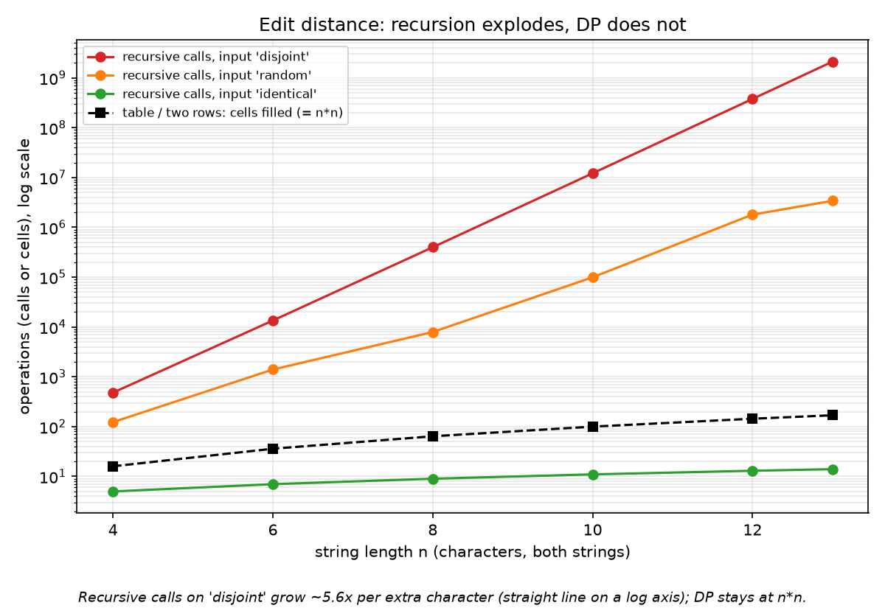
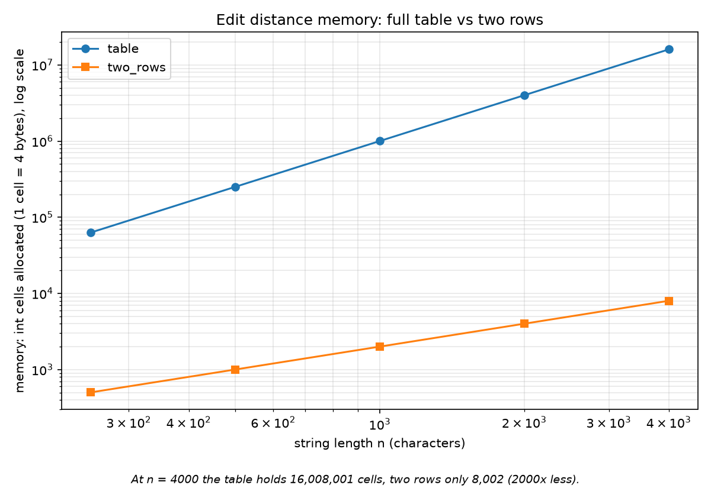
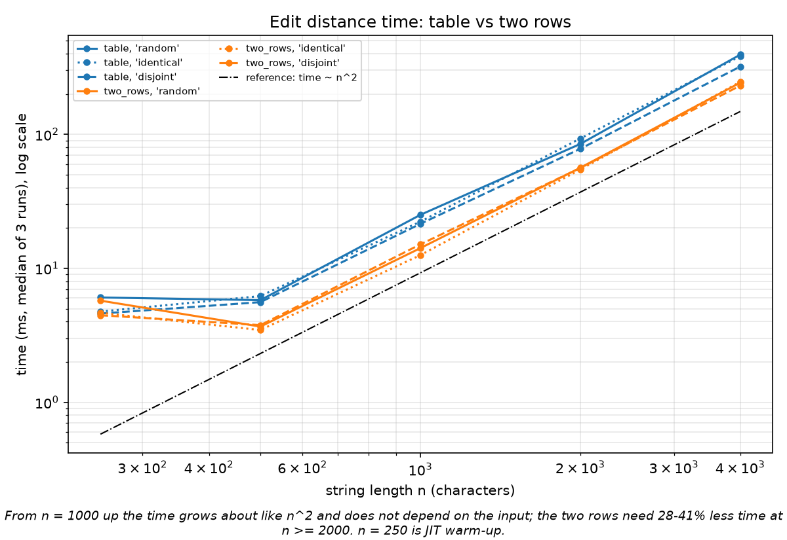
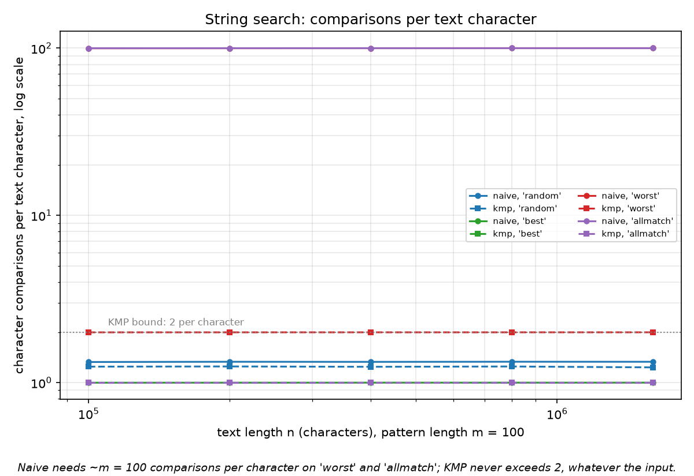
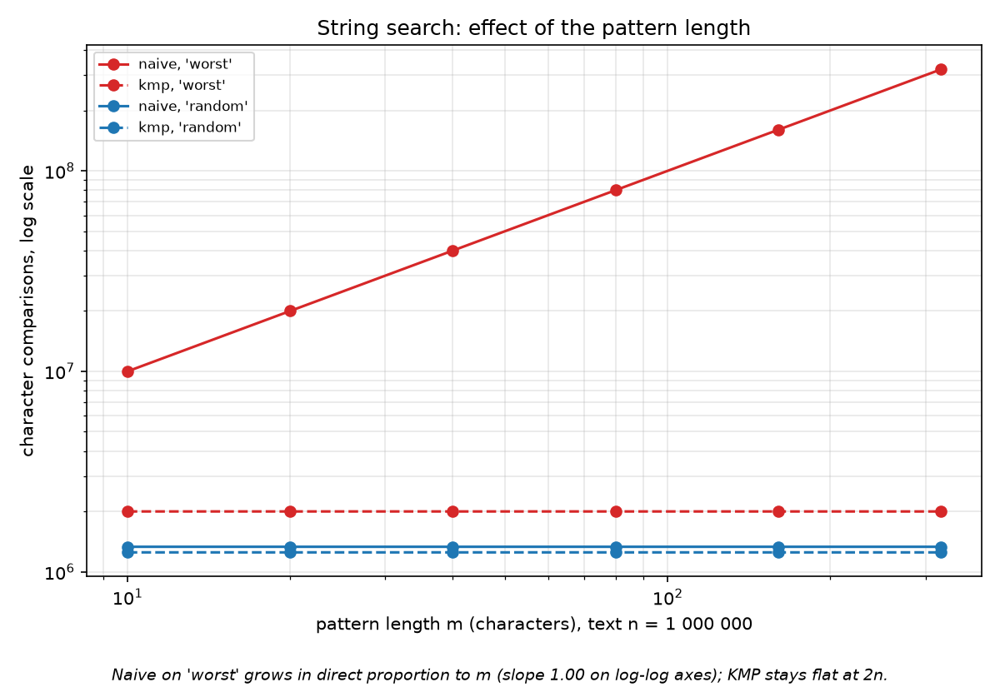
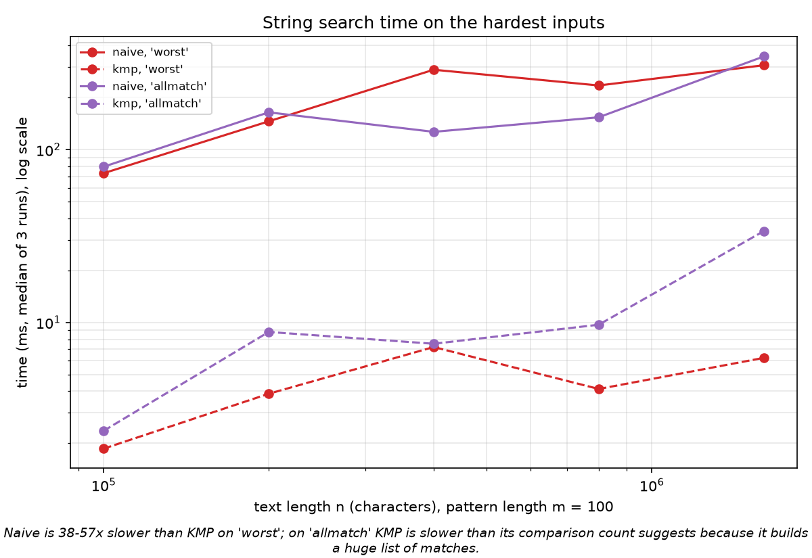

# Report - Assignment 4: Dynamic Programming and String Algorithms

## 1. Experiment Design Card

*(Written before the first run of the experiment. Changes made after the first run are listed in section 5.)*

| Field | Content |
|---|---|
| **Question** | **Edit Distance:** does the recursive version really explode exponentially while the table versions grow like n*m, and what do the two rows give us compared with the full table? **String search:** does Naive really degrade to n*m on a bad input while KMP stays below 2n comparisons, whatever the input? |
| **Sizes (n)** | **E1, all three edit distance versions:** n = 4, 6, 8, 10, 12, 13 (both strings of length n). The recursion makes about 5-6 times more calls with every extra character, so n = 13 is already around two billion calls; I stop there so that nothing runs for minutes. **E2, table and two rows:** n = 250, 500, 1000, 2000, 4000 (largest = 16 x smallest; 4000 x 4000 = 16 million cells, about 50-100 ms, so the clock is not 0 ms). **E3, search with growing text:** n = 100 000 ... 1 600 000 (doubling, 16 x), pattern length m = 100. **E4, search with growing pattern:** text n = 1 000 000, m = 10, 20, 40, 80, 160, 320 (32 x). |
| **Inputs** | *Edit distance:* **random** (alphabet {a,b,c,d}, typical case); **identical** (b = a, best case for the recursion because it only follows the diagonal); **disjoint** (a over {a,b}, b over {c,d}: no common character, worst case for the recursion because every call branches three ways). *Search:* **random** (DNA-like text over ACGT, pattern copied from the middle of the text, so there is a match); **best** (text AAAA..., pattern B+AAA...: the first character never matches, best case for Naive); **worst** (text AAAA..., pattern AAA...AB: almost a match at every position, worst case for Naive); **allmatch** (text AAAA..., pattern AAA...A: a match at every position, overlapping matches, largest output). |
| **Metrics** | *Edit distance:* `ops` = recursive calls (version A) or table cells filled (B, C), because the cost of DP is the number of states computed; `mem_cells` = int cells allocated, because the two rows are about memory; the time (median of 3 runs). *Search:* `ops` = character comparisons in the search phase, because both algorithms spend their time on them; `prep_ops` = comparisons while building LPS (KMP preprocessing); time (median of 3 runs). All counters are incremented inside the algorithms. |
| **Prediction** | *Recursive:* on `disjoint` the calls grow by a factor of about 5.5-5.8 for every extra character (a straight line on a log axis, base about 3 + 2*sqrt(2) = 5.83); on `identical` the calls are n + 1 (linear); `random` lies in between and also grows exponentially, with a smaller base. *Table / two rows:* ops = n*n exactly for every input (DP does not look at the content), time grows about 4 times when n doubles; the two rows are about as fast as the table or a little faster, with memory (n+1)^2 against 2(n+1). *Naive:* `best` about 1 comparison per text character, `random` about 1.3 (1 / (1 - 1/4)), `worst` and `allmatch` about m = 100 per text character; the cost grows linearly with m. *KMP:* between 1 and 2 comparisons per text character on every input, never more than 2n, and independent of m. *Time:* Naive on `worst` should be many times slower than KMP; on `best` and `random` the two should be close. |
| **Plots** | 1. Recursive calls vs n (log y axis), one line per input, with table cells for comparison: does the recursion explode? 2. Memory cells vs n (log-log), table against two rows: what do the two rows save? 3. Time vs n (log-log), table against two rows: does the time follow n^2 and do the two rows cost anything? 4. Comparisons per text character vs n (ratio), Naive and KMP on every input: which input is worst and does KMP stay below 2? 5. Comparisons vs pattern length m (log-log) at fixed text: does Naive grow with m and KMP not? 6. Time vs n on the worst input, Naive against KMP (log-log). |

## 2. Plots and results

All numbers come from `results/results.csv` (149 lines = 148 runs; fixed seeds; reproduce with `mvn -q compile exec:java`). Counters are incremented inside the algorithms. Where lines lie exactly on top of each other (for example Naive 'worst' and 'allmatch' in plot 4), they have the same values.

**Plot 1.** Recursive calls on 'disjoint' grow about 5.6 times per extra character (a straight line on a log axis, n = 13 needs 2.1 billion calls), while the DP versions fill only n*n cells.

**Plot 2.** At n = 4000 the table holds 16 008 001 cells (64 MB), two rows only 8 002 (32 KB), 2000 times less.

**Plot 3.** From n = 1000 up the time grows about like n^2 (slope 1.99 for the table, 2.05 for two rows) and does not depend on the input; the two rows need 28-41% less time at n >= 2000; n = 250 is JIT warm-up.

**Plot 4.** Naive needs about m = 100 comparisons per text character on 'worst' and 'allmatch', KMP never exceeds 2 on any input and stays flat as n grows.

**Plot 5.** Naive on 'worst' grows in direct proportion to the pattern length (slope 1.00 on log-log axes), KMP stays flat at 2n comparisons.

**Plot 6.** Naive is 38-57 times slower than KMP on 'worst'; on 'allmatch' KMP is slower than its comparison count suggests, because it builds a list of 1.6 million matches.

## 3. Prediction vs result

**Edit distance.**
* *Recursive.* Predicted: about 5.5-5.8 times more calls per character on 'disjoint', n + 1 calls on 'identical', exponential but with a smaller base on 'random'. Seen: x5.60 per character from n = 12 to 13 (and x28 to x31 for every two characters before that), exactly n + 1 calls on 'identical' (14 calls at n = 13), and on 'random' growth between x1.9 and x4.3 per character, which is irregular because every n uses one fixed random pair. The input matters enormously: at n = 13 'random' needs 3.4 million calls and 'disjoint' 2.1 billion (about 600 times more).
* *Table and two rows.* Predicted: ops = n*n for every input, time x4 when n doubles, two rows as fast or a little faster. Seen: ops = n*n exactly for all inputs and both versions; for 'random' the time grew x3.4 (1000 to 2000) and x4.6 (2000 to 4000) for the table and x4.0 and x4.3 for two rows, slopes 1.99 and 2.05 for n >= 1000; two rows needed 28-41% less time at n >= 2000, a bit more than I expected. **Surprise:** at n = 250 the table needed 6.1 ms, more than at n = 500 (5.8 ms) although it fills four times fewer cells: 97 ns per cell at n = 250 against 23 ns at n = 500 and 25 ns at n = 4000. It is JIT warm-up of a cold JVM, so the first points of a time curve cannot be trusted; the counter (62 500 cells) is correct.

**String search.**
* *Naive.* Predicted 1 / 1.3 / ~100 / ~100 comparisons per character on best / random / worst / allmatch. Seen: 1.000 / 1.333 / 99.9-99.99 / 99.9-99.99, and linear growth with m (slope 1.00).
* *KMP.* Predicted between 1 and 2, never more than 2n. Seen: 1.000 on 'best' and 'allmatch', 1.23-1.25 on 'random' and exactly 2.000 on 'worst', so the 'worst' input also reaches KMP's own upper bound; the value does not depend on m. The LPS preparation needed 99-637 comparisons (at most 2m), nothing next to n.
* *Time.* Predicted Naive many times slower on 'worst', close on 'best' and 'random'. Seen: 308 ms against 6.2 ms (49 times) at n = 1.6 million, and 38-57 times at every size; on 'random' 10.1 against 9.7 ms and on 'best' 3.2 against 3.6 ms. **Surprise:** KMP on 'allmatch' took 33.8 ms at n = 1.6 million, 5.4 times longer than on 'worst' (6.2 ms), although it makes only 1 comparison per character instead of 2. The reason is the output: 1.6 million matches are stored as boxed Integers in an ArrayList, so the time is spent on allocation, not on comparing. The counters show the cost of the search; they do not show the cost of the output.

## 4. Short answers

**Which input made your string search slowest, and why?** By the counters it is Naive on 'worst' (text AAAA..., pattern AAA...AB) and on 'allmatch': about 100 comparisons per text character, which is n*m in total (308 ms and 346 ms at n = 1.6 million, against 3.2 ms on 'best'). At every start position Naive compares 99 matching characters, fails on the last one and moves one step to the right, throwing away everything it just learned and comparing the same characters again at the next position. Repetitive logs ("ERROR ERROR ERROR ...") look exactly like this. KMP's own worst input is also 'worst', where it makes exactly 2n comparisons, the proven upper bound.

**How large an n could the recursive Edit Distance handle, and what stopped it?** On the worst input ('disjoint') n = 12 took 0.85 s (377 million calls) and n = 13 took 6.9 s (2.1 billion calls). Every extra character multiplies the calls by 5.6 (and the time by even more, 8 times from 12 to 13), so by extrapolation with about 3.3 ns per call (not measured) n = 14 would need about 40 s, n = 16 about 20 minutes and n = 18 about 11 hours; I stopped at 13. Time stopped it, not memory: the recursion is only n + m = 26 calls deep, so there is no stack problem. On easy inputs it goes much further ('identical' needs only n + 1 calls), so the limit depends on the input, but a safe size for any input is only about 12.

**What do you gain and lose with two rows instead of the full table?** We gain memory: 8 002 instead of 16 008 001 cells at n = 4000 (32 KB instead of 64 MB, O(m) instead of O(n*m)), and also 28-41% less time at n >= 2000, because two small rows stay in the cache while the big table does not. The number of operations is exactly the same (n*m). We lose the table itself: with only two rows the actual sequence of insertions, deletions and replacements cannot be traced back, we only know how many there are. It is also impossible to answer further questions about other prefixes from the same table.

**Which string search for the city platform?** KMP. It guarantees at most 2n comparisons on every input, while Naive can become 100 times slower in comparisons (38-57 times in time) on the repetitive logs the operators will search (plot 4, plot 6), and where Naive is fine (random text) KMP is just as fast (9.7 against 10.1 ms), so nothing is lost; the price is a small LPS array of m numbers. For misspelled street names ("Abylai Han") the right tool is not exact search but Edit Distance: names are short, so the two-row version with n*m of a few hundred cells is enough, and the full table is needed only if we want to show which letters to correct.

## 5. Changes after the first run

The experiment design (sizes, inputs, metrics, plots) was not changed after the first run. Only the text of the report and the captions of the plots were updated to match the measured numbers.

## 6. Time (one paragraph)

Times are the median of 3 runs. The largest runs took 393 ms (table, n = 4000, 16 million cells), 243 ms (two rows), 6.9 s (recursive, n = 13, disjoint), 308 ms (Naive, worst, n = 1.6 million) and 6.2 ms (KMP on the same text). The big differences (recursion against DP, Naive against KMP on 'worst') are visible in both the clock and the counters, but small differences are not reliable: at n = 250 the table needed more time than at n = 500 only because the JVM was still warming up; Naive on 'allmatch' took 164 ms at n = 200 000 but only 127 ms at n = 400 000 although the work doubled, and Naive on 'worst' took 290 ms at n = 400 000 and 235 ms at n = 800 000 (background load or garbage collection); and KMP on 'allmatch' was slow because of the output list and not because of comparisons. Another laptop, another JVM version or another background load will give other times, while the counters (for example 2 114 900 428 recursive calls, 100 comparisons per character) were identical on the two computers I compared. That is why the conclusions above are based on the counters, and the clock is used only to confirm them.
